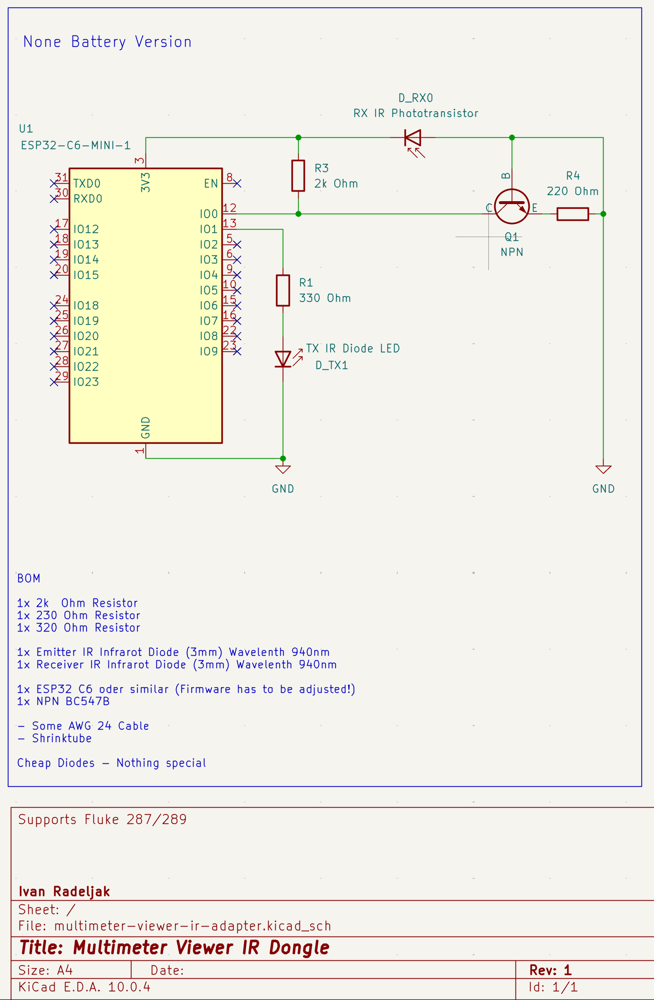
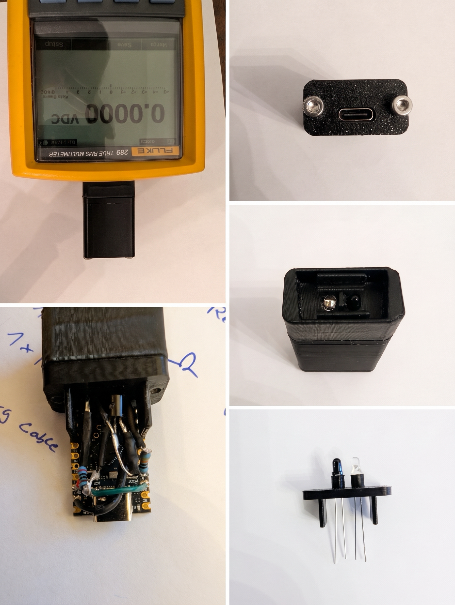

# 28x IR Dongle: Hardware

Everything you need to build the dongle: schematic, parts list, 3D-printed
parts and assembly photos. For flashing and troubleshooting, see the
[firmware guide](../firmware/28x-ir-dongle/README.md).

## Schematic

  

## Bill of materials

### Electronics

| Qty | Part                    | Notes                                  |
|-----|-------------------------|----------------------------------------|
| 1   | ESP32-C6 board          | Other boards need firmware adjustments |
| 1   | IR LED, 3 mm, 940 nm    | Transmitter; a cheap one is fine       |
| 1   | IR receiver, 3 mm, 940 nm | Receiver; a cheap one is fine        |
| 1   | BC547B NPN transistor   |                                        |
| 1   | 2 kΩ resistor           | Axial                                  |
| 1   | 230 Ω resistor          | Axial                                  |
| 1   | 320 Ω resistor          | Axial                                  |

### Case

| Qty | Part                 | Notes                         |
|-----|----------------------|-------------------------------|
| 2   | M3 × 30 mm screw     | The new case will need 30 mm  |
| 2   | M3 × 4 × 4.2 mm heat-set insert |                    |

### Wiring

- AWG 24 wire
- Heat-shrink tubing

## 3D-printed parts

The files are in the [STL](STL) folder. The number in each file name tells you
how many to print.

| Qty | File                               | Notes                       |
|-----|------------------------------------|-----------------------------|
| 1   | [1x_Plug.stl](STL/1x_Plug.stl)     | **Print vertically**        |
| 1   | [1x_Shell.stl](STL/1x_Shell.stl)   |                             |
| 1   | [1x_Cover.stl](STL/1x_Cover.stl)   |                             |
| 1   | [1x_Sandwich.stl](STL/1x_Sandwich.stl) |                         |
| 2   | [2x_Spacer.stl](STL/2x_Spacer.stl) |  |

> [!WARNING]
> Print `1x_Plug.stl` vertically. Layers bond less strongly along the Z axis,
> so the clips can break if they are printed in any other orientation.

> [!WARNING]
> Use non-conductive filament only, so avoid conductive, carbon-filled or
> metal-filled types. I recommend ASA. ABS also works, and PETG is an
> alternative.

## Assembly

> [!IMPORTANT]
> Read the schematic before you start soldering. It's a tight fit!

  

> [!NOTE]
> The BC547B in the photo is fitted with collector and emitter swapped. The
> dongle still works this way, so it's not a problem, but follow the schematic
> when you build yours.

The exact wiring is hard to show in photos, so use them as a rough guide. My
tip: before you start soldering, take a moment to plan how to route the wires
and where each part will sit. Plan the heat-shrink tubing too and slide it on
before you solder, because the many branches make that hard to do later.
