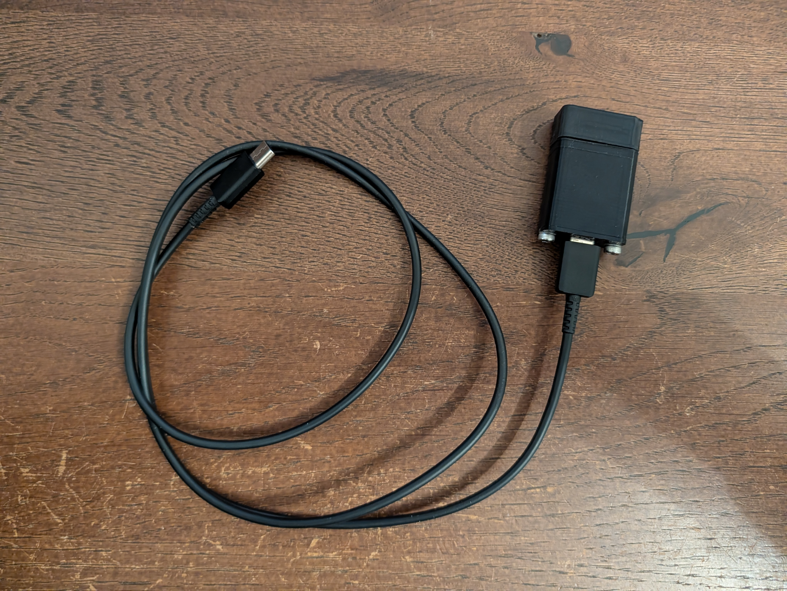

# 28x IR Dongle

Self-built IR adapter for digital multimeters with an optical serial port,
compatible with the Fluke 287 and 289. It connects the meter to
[Multimeter Viewer](https://github.com/irii/multimeter-viewer) over
Bluetooth LE or USB.

  

| Folder                                             | Contents                                   |
|----------------------------------------------------|--------------------------------------------|
| [28x-ir-dongle](28x-ir-dongle)                     | Schematic, parts list, STL files, assembly |
| [firmware/28x-ir-dongle](firmware/28x-ir-dongle)   | ESP32 firmware and troubleshooting         |

## TODO

- [ ] Battery-powered adapter (WIP)
- [ ] SD card support for extended measurements
- [ ] USB-C power terminal to replace the battery compartment of the Fluke 287/289, for longer measurements, with shared power for the IR adapter

## Personal use only

The 3D models are meant for building an adapter for yourself. You may
print, use, change and share them for personal, non-commercial purposes.
**Selling them is not allowed**, whether as files, printed parts, kits or
finished adapters, and so is any other commercial use.

## License

© 2026 Ivan Radeljak

- **3D models** ([28x-ir-dongle](28x-ir-dongle)) and everything else outside
  `firmware/`: [CC BY-NC-SA 4.0](LICENSE). Changed versions must be shared
  under the same license and credit this project.
- **Firmware** ([firmware/28x-ir-dongle](firmware/28x-ir-dongle)):
  [MIT](LICENSE-MIT).

## Disclaimer

Provided "as is", without warranty of any kind. Building and using the
adapter is at your own risk; it may give wrong or missing readings. Do not
rely on it for safety-relevant measurements.

## Trademarks

Fluke is a trademark of Fluke Corporation. This project is not affiliated
with or endorsed by Fluke Corporation. The name is used only to identify the
compatible devices.
